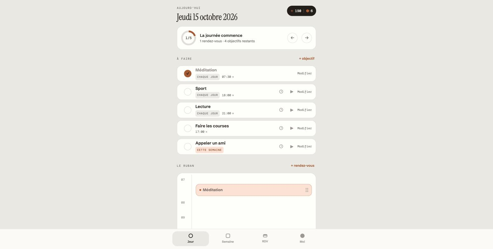
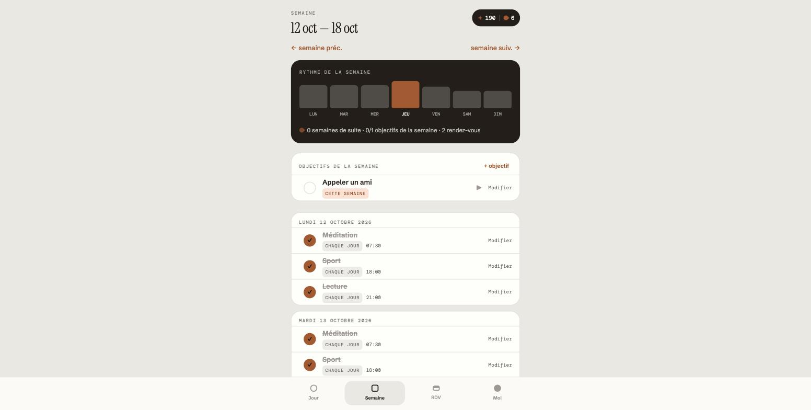
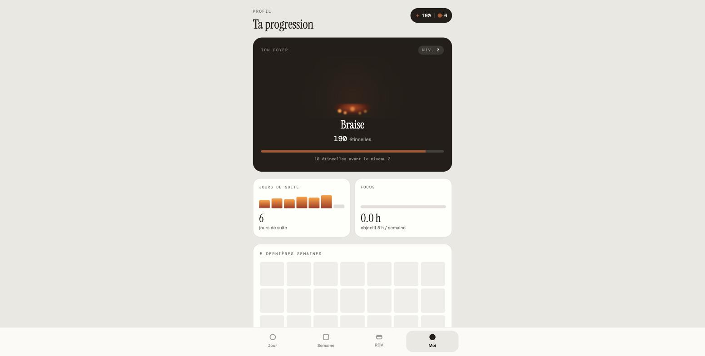
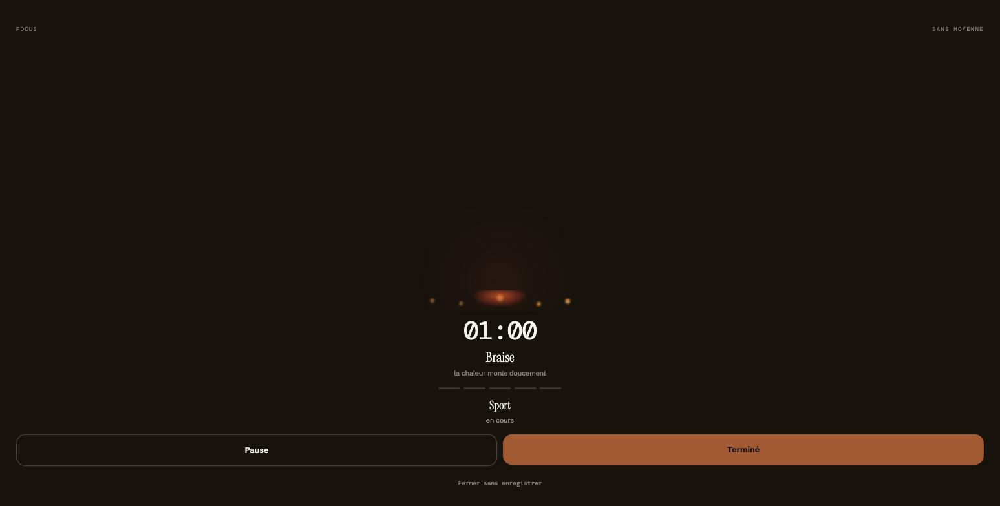

# Move the Spark

[](https://github.com/Newprotagonist/move-the-spark/actions/workflows/ci.yml)

Application de planification (PWA) : objectifs quotidiens/hebdomadaires avec gamification
simple, rendez-vous, chrono d'objectifs, et rappels par notification push. Conçue et développée
seul, du produit à l'infra — en prod depuis août 2026 sur [movethespark.com](https://movethespark.com).
Voir `SPEC.md` et `PLAN.md` pour le détail des choix produit et techniques au fil de l'eau —
rédigés avec [Claude Code](https://claude.com/claude-code), qui a aussi assisté une bonne
partie du développement.

Quelques points qui sortent d'un CRUD Rails standard :
- **PWA complète** : installable, notifications Web Push (VAPID), fonctionne hors-ligne pour
  la lecture.
- **Jobs planifiés sans infra supplémentaire** (Solid Queue, pas de Redis/Sidekiq) pour les
  rappels de rendez-vous et d'objectifs du jour.
- **Multi-utilisateur, sur invitation uniquement** : chaque compte ne voit que ses propres
  données (voir ci-dessous) — pas d'inscription publique, pas de données partagées.
- **Déployée moi-même** (Kamal + Hetzner) plutôt que sur une plateforme managée.

## Captures d'écran

| Jour | Semaine |
|---|---|
|  |  |

| Profil (progression) | Mode Focus |
|---|---|
|  |  |

*(Captures prises avec un compte de démonstration à données factices.)*

## Comptes & confidentialité

Pas d'inscription publique : seul l'opérateur du serveur crée des comptes, pour des proches
invités (voir [`lib/tasks/users.rake`](lib/tasks/users.rake)). Chaque compte est strictement
cloisonné — objectifs, rendez-vous, réglages et abonnements notifications d'un utilisateur ne
sont jamais visibles par un autre.

Ce qui est stocké : l'email (identifiant de connexion), le mot de passe (haché, jamais en
clair — `has_secure_password`/bcrypt), et les données que l'app sert à planifier (objectifs,
rendez-vous, historique de complétion). Rien n'est partagé avec un tiers. Un compte et toutes
ses données peuvent être supprimés intégralement sur demande.

## Prérequis

- Ruby (voir `.ruby-version`)
- Pas de base de données externe : tout tourne sur SQLite (fichiers dans `storage/`)

## Installation

```bash
bin/setup
```

(ou manuellement : `bundle install && bin/rails db:prepare`)

## Lancer l'app en local

```bash
bin/dev
```

Démarre le serveur Rails + le watcher Tailwind. Ouvrir **http://localhost:3000**.

Pour que les rappels programmés fonctionnent (rendez-vous à venir, objectifs du jour non
faits), lancer en parallèle le worker Solid Queue :

```bash
bin/jobs
```

Sans `bin/jobs`, l'app fonctionne normalement mais aucune notification push n'est envoyée
(les jobs `AppointmentReminderJob` / `DailyGoalReminderJob`, programmés toutes les 5 minutes
via `config/recurring.yml`, ne tournent pas).

### Créer un compte

Pas d'inscription dans l'interface — un compte se crée via une tâche rake (affiche un mot de
passe généré, une seule fois) :

```bash
bin/rails "users:invite[quelqu.un@example.com]"
```

Mot de passe oublié (pas d'email configuré — le lien se transmet à la main) :

```bash
bin/rails "users:reset_password_link[quelqu.un@example.com]"
```

## Notifications push

Nécessite un navigateur servant l'app en HTTPS *ou* en localhost (les deux sont autorisés par
les navigateurs pour Service Worker + Push). Pour activer :

1. Aller dans **Réglages** (⚙ dans le menu).
2. Cliquer sur "Activer les notifications" et accepter la permission du navigateur.

Les clés VAPID sont déjà générées et stockées dans les credentials chiffrées Rails
(`config/credentials.yml.enc`, sous la clé `vapid`). Pour les régénérer :

```bash
bin/rails runner "k = Webpush.generate_key; puts k.public_key; puts k.private_key"
bin/rails credentials:edit
# puis mettre à jour vapid.public_key / vapid.private_key
```

> Note technique : le gem `webpush` utilise une API OpenSSL incompatible avec les versions
> récentes du gem `openssl` (OpenSSL 3+, clés EC immuables). Un correctif est appliqué dans
> `config/initializers/webpush_openssl3_compat.rb` — à retirer si `webpush` publie un jour un
> correctif upstream.

## Tests

```bash
bin/rails test           # tests unitaires / requêtes
bin/rails test:system    # tests système (Capybara + Chrome headless)
```

Même suite exécutée en CI sur chaque PR ([`.github/workflows/ci.yml`](.github/workflows/ci.yml)),
avec rubocop, brakeman et bundler-audit/importmap-audit en plus.

## Déploiement

Kamal vers un serveur Hetzner unique, image Docker buildée et poussée sur `ghcr.io` (voir
`config/deploy.yml`). SQLite tourne directement sur le serveur (volume Docker persistant),
pas de base de données externe à gérer.

Nécessite quelques variables d'environnement côté opérateur (jamais commitées) :
`PLANNER_SERVER_IP`, `KAMAL_REGISTRY_PASSWORD` (token `ghcr.io`), et `RAILS_MASTER_KEY`
lu automatiquement depuis `config/master.key` (voir `.kamal/secrets`).

```bash
kamal deploy
```

## Stack

Rails 8 (authentification via le générateur intégré — pas de Devise), SQLite, Solid Queue
(jobs planifiés, zéro infra supplémentaire), Tailwind CSS, Turbo + Stimulus (pas de framework
JS séparé), gem `webpush` pour les notifications Web Push.
